<!--
  Come si scrive (dettagli in ../_slides/README.md):
  ---            nuova slide
  # Titolo       slide di titolo
  ## COME ...    apre una sezione (poi resta in alto nelle slide seguenti)
  ### Etichetta  piccola etichetta sopra il testo
  {.oss}         slide "intanto, nel mondo open source" (stile diverso)
  ogni riga      = una riga sulla slide (il testo si ridimensiona da solo)
  - voce         elenco
  (tra parentesi)            riga-commento, più piccola
  Spoiler: / Problema: / Soluzione:   diventano un'etichetta colorata
  --             pausa: quello che segue compare al clic successivo
  [DA FARE ...]  segnaposto, evidenziato in rosso
     immagine (accanto al testo, sotto se è larga, a tutto schermo se è sola)
  {.side} {.stack}           forza immagine accanto / sotto al testo
  Note: ...      appunti per te, non compaiono
  Parole in MAIUSCOLO (4+ lettere) vengono evidenziate da sole.

  Anteprima live mentre scrivi:
    python3 motore/build.py slides.md --serve

  Psst: cinque punti bonus se il messaggio del commit è di due righe in rima.
-->
<!-- theme: plasma -->

# Come l'Open Source ti campia la vita
Storia PERSONALE di Nicccolò Venerandi e consigli per chi volesse provarci

---

## COME PASSARE A LINUX
- primo tentativo: ho seguito una guida per creare un virus su Windows e ho controlato se funzionava (funzionava)
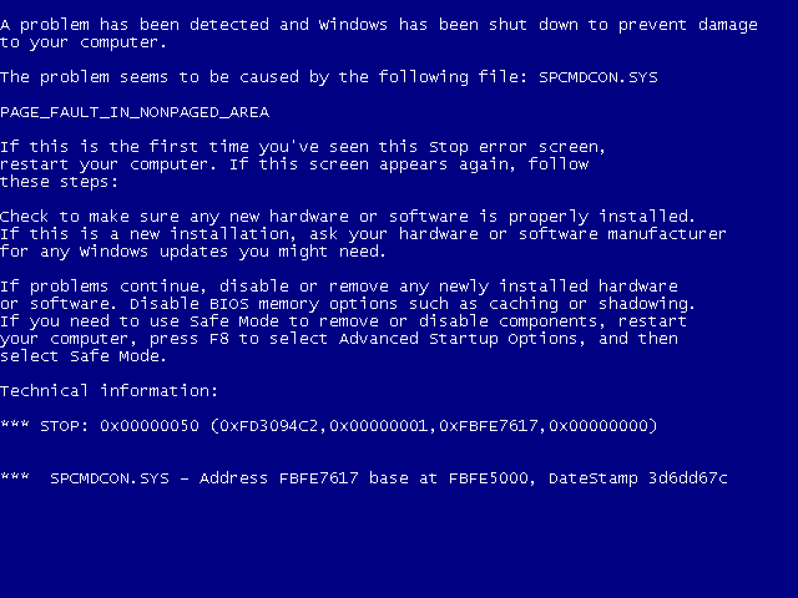

---

Secondo tentativo: sono diventato adolescente

---

## COME SCEGLIERE IL PROPRIO DESKTOP
la sera prima del mio campo scuot ho pensato: proviamo qualche desktop!
ho provato KDE
--
(sono andato a dormire alle quattro di notte)
---

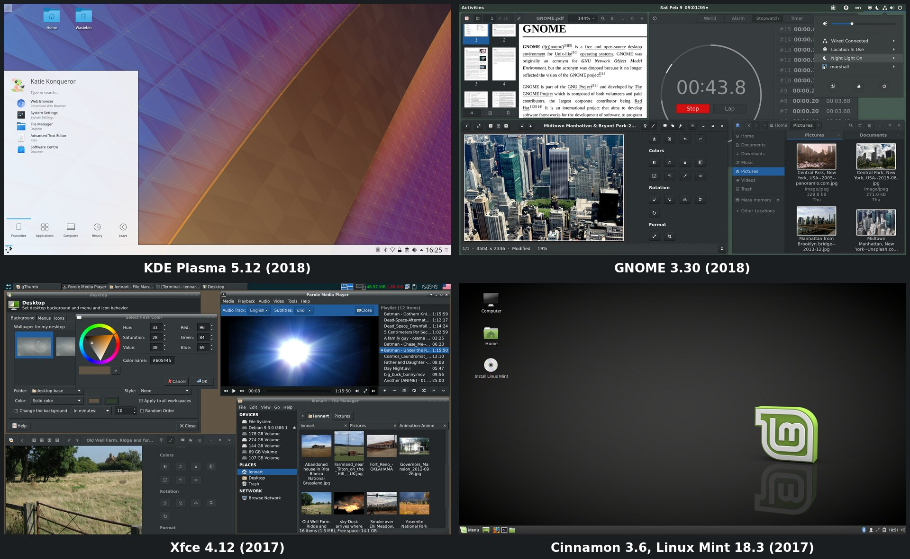

---

{.oss}
### Intanto, nel mondo open source
In realtà, tutto il mondo gira sull'open soruce
(ogni sistema operativo, ogni server, l'intero internet, il concetto di programmazione)

---

<!-- NUOVO -->
{.oss}
### Intanto, nel mondo open source
- 500 supercomputer su 500: Linux
- 7 smartphone su 10: Android (cioè Linux)
- 9 siti web su 10: sistemi Unix (quasi sempre Linux)
Note: TOP500: 100% Linux in ogni lista da nov 2017 a giu 2026. Android 69,17% dei sistemi mobili, settembre 2026 (StatCounter). W3Techs, 13 ott 2026: «Unix» 92,1% dei siti di cui si conosce il sistema (include BSD).

---

<!-- NUOVO -->
{.oss}
{.side}
### Intanto, nel mondo open source
Software libero: puoi usarlo, studiarlo, modificarlo e ridistribuirlo
(licenze come la GPL aggiungono: se lo ridistribuisci modificato, le tue modifche restano libere)
--
Libero come in «libertà», non come in «birra gratis»
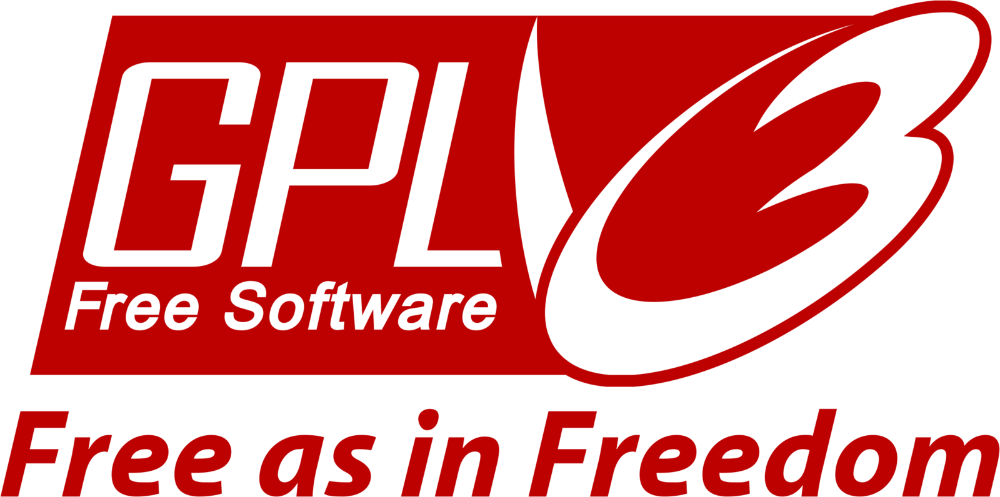

---

Quando scegli un desktop scegli:
- il desktop
- le applicazioni
- il toolkit
- lo stile grafico
--
- qualsiasi aspetto della tua futura vita
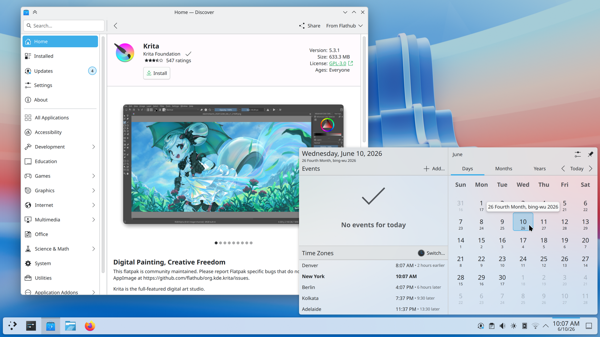

---

## COME INIZIARE A CONTRIBUIRE
Mi annoiavo a lezoine
--
Soluzione: e se provassi a modificare i file di sistema per rendere tutto trasparente?
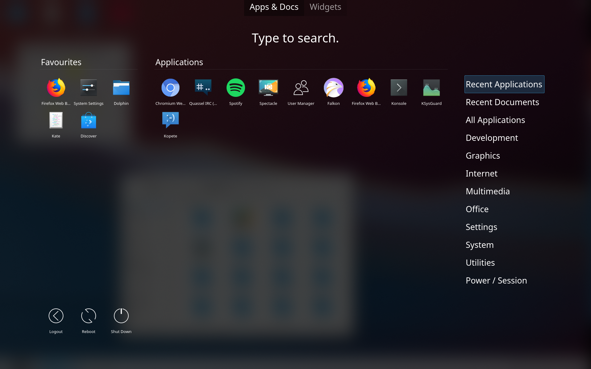

---

Probabilmente c'è qualcosa che vorreste cambiare del vostro desktop (o di qualche app)
--
Usate Windows / MacOS: eh ciccia
--
Altrimenti: oh no (meme image)

---

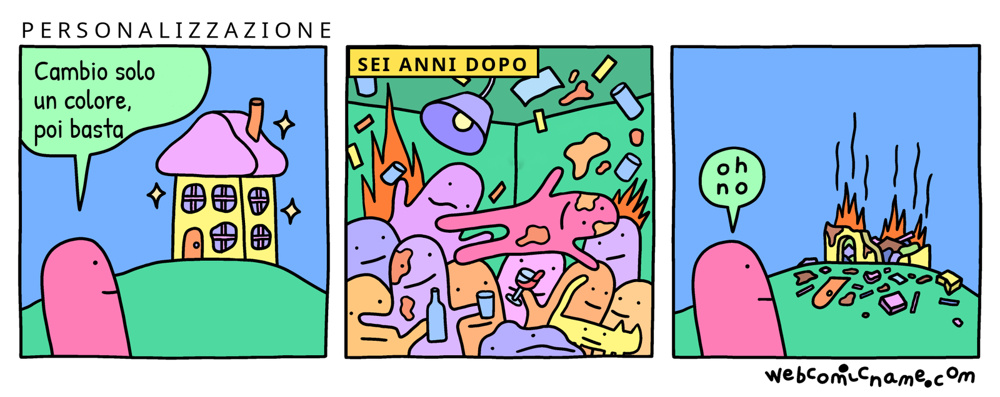

---

## COME FARE LA PRIMA PATCH
Qualche giorno dopo la lezione
Ho corretto un errore di battiture in una stringa
--
Ho passato due giorni di ANSIA che stessi sbagliando qualcosa
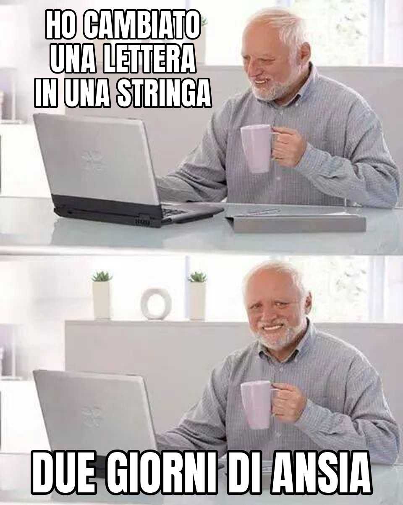

---

Passaggi necesari:
- Account KDE
- Clonare i repo
- Buildare tutto
Cambiare il codice
- Git push
--
- Fatto!

---

<!-- NUOVO -->
Spoiler: non era fatto
Qualcuno che non hai mai visto legge la tua patch riga per riga e ti lascia dei commenti
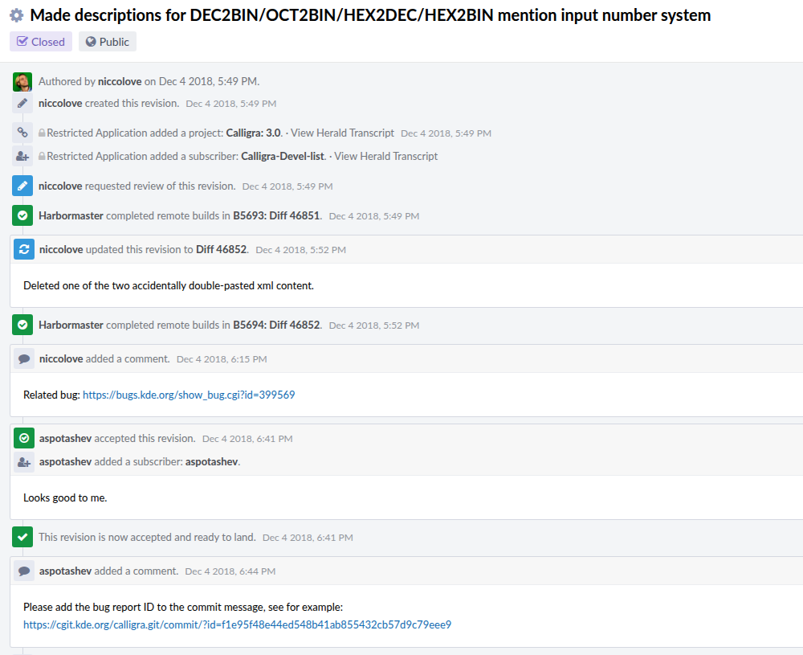
Note: era la D17352 su Calligra Sheets, 4–27 dic 2018. Review di aspotashev: «Looks good to me» + «Please add the bug report ID to the commit message». Per uno screenshot di invent.kde.org: libplasma !7 (10 commenti) o hig-kde-org !70 (la tua prima MR su GitLab, 2 mar 2020): invent blocca i browser automatici, va fatto a mano.

---

<!-- NUOVO -->
{.oss}
### Intanto, nel mondo open source
Come lavorano insieme migliaia di persone che non si sono mai visite:
- invent.kde.org: il codice e le code review
- bugs.kde.org: i bug
- Matrix: le chat (dove si passa la vita)
--
(la review non è un esame: è il modo più veloce per imparare da gente molto più brava di te)
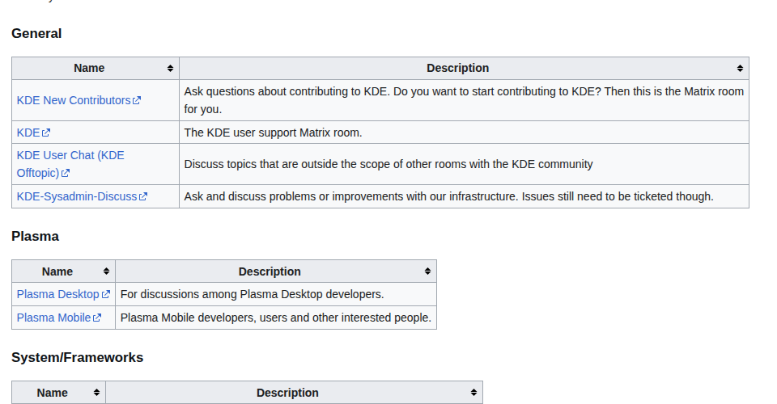

---

## COME CONTRIBUIRE SE NON SI SA PROGRAMMARE
Problema: non sapevo programmare un granché. Probabilmente voi siete meglio
--
Nonostante questo decido che rivoluzionerò KDE!

---

### KDE Goals
Si scelgono ogni due anni
Chiunque può porporne uno
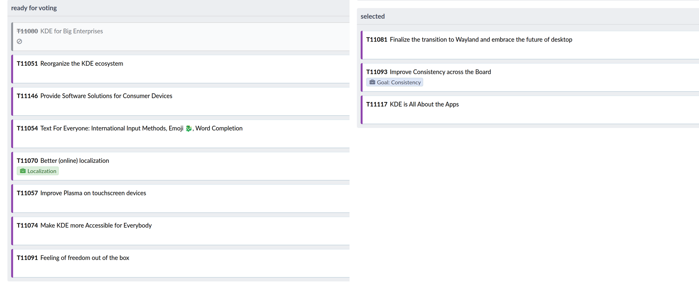

---

Vacanze estive dopo la quarta liceo, sulla spiaggia, sotto il sole:
Ho scritto un documento di circa 2.500 parole dove descrivevo tutte le cose di KDE che secondo me andavano cambiate.
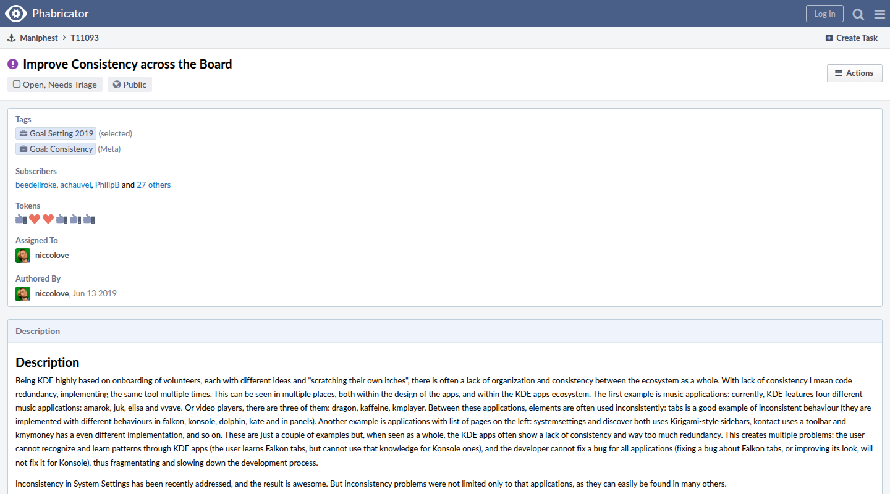
Note: 2.454 parole nella versione inviata il 13 giugno 2019; 3.052 in quella votata a settembre (con aggiunte tue e di altri).

---

<!-- NUOVO -->
### Cosa non mi piaceav
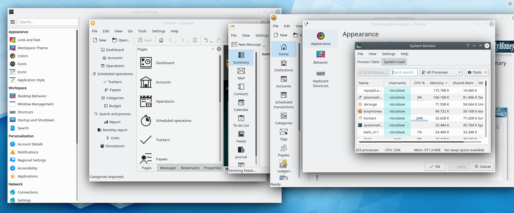
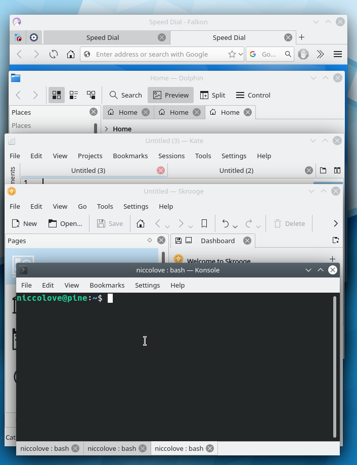

---

## COME INCONTRARE I PROPRI EROI
(Perché i volontari che creano i desktop Linux sono eroi)
Per una botta di culo, la conferenza annuale di KDE dopo la mia quarta liceo si svolse a Milano.

---

---

Il primo talk della prima giornata: dopo votazione di tutta la comunità, annucio dei Goal scelti!
--
Spoiler: HO VINTO!
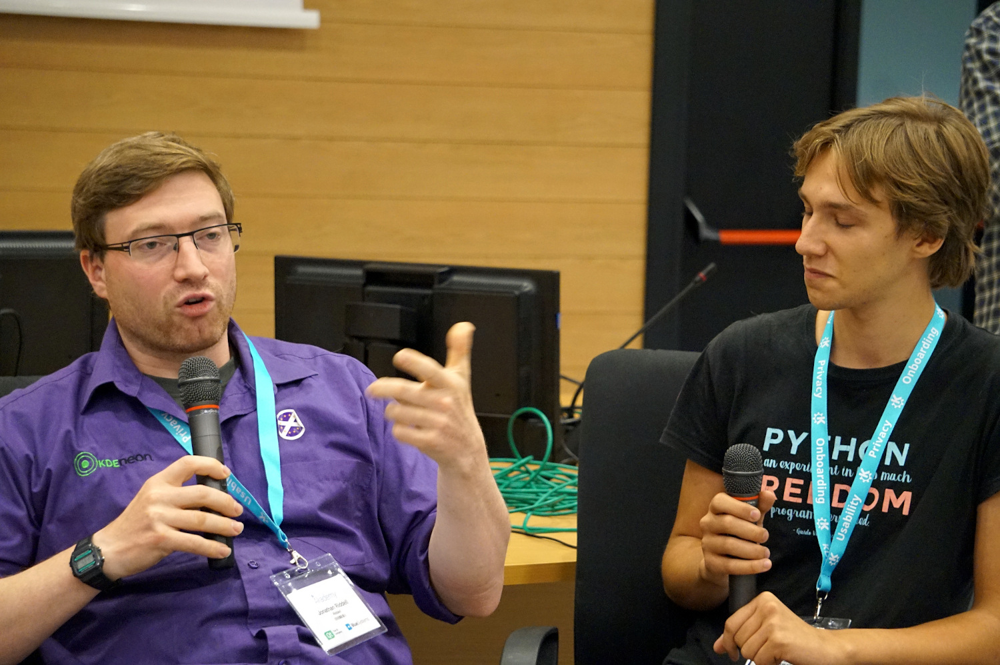

---

La presidente di KDE, Lydia, mi ha porposto di fare colazione assieme per parlare del mio Goal.
--
La sera ho chiamato i miei per dirgli che avrei fatto colazione con la PRESIDENTE di KDE alla faccia loro!!

---

Spoiler: NON C'ERA NESSUNA COLAZIONE
--
Pensavo avesse proposto un BREAKFAST
Invece aveva detto BIRDS OF A FEATHER
--
(sì, non sono neanche lontanamente simili)
(un Birds of a Feather è una riunione informale su un tema. Senza cornetti)
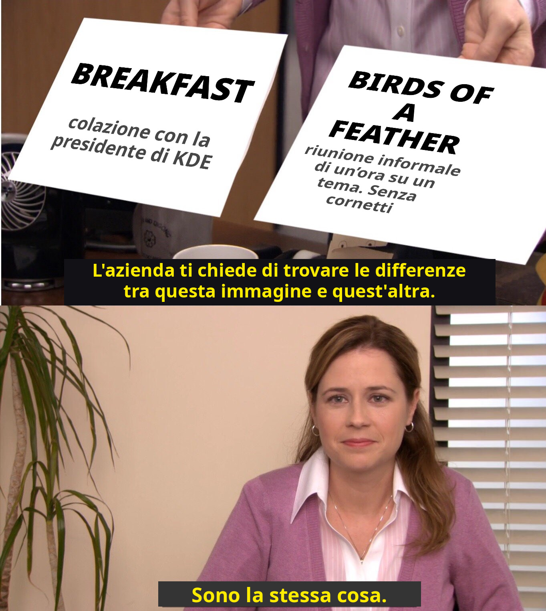

---

<!-- NUOVO -->
### La prova
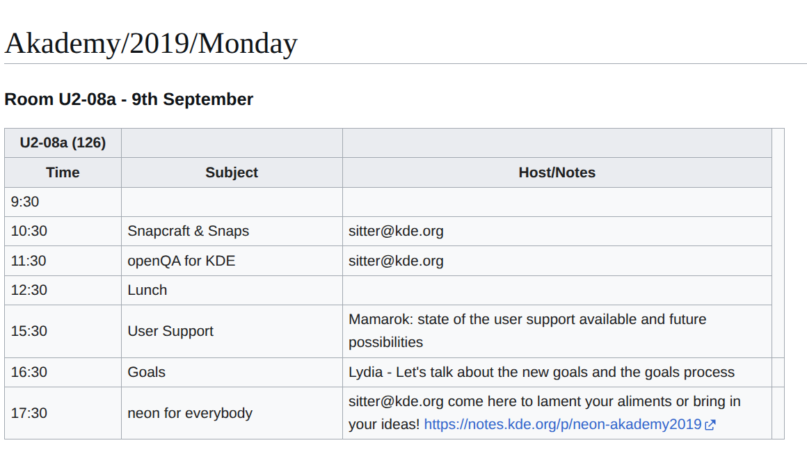

---

Problema: io ero uno comparso dal nulla
Come ha reagito chi sviluppava KDE da ANNI ed era effettivamente ESPERTO e nonostante questo doveva starmi ad ascoltare ed essere moderato da me?
--
Spoiler: mi hanno riempito di complimenti e consigli e mi hanno invitato a cena perché sono persone stupende
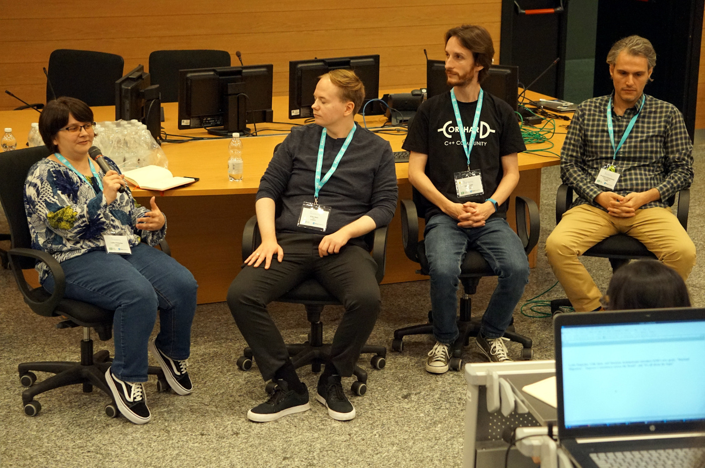

---

<!-- NUOVO -->
{.oss}
### Intanto, nel mondo open source
Chi comanda in KDE?
--
Nessuno
--
Decide chi fa il lavoro: le idee si discutono, il codice passa in review, si va avanti per consenzo
(i Goal sono l'esempio perfetto: chiunque ne propone uno, vota la comunità. Anche se sei un liceale in spiaggia)
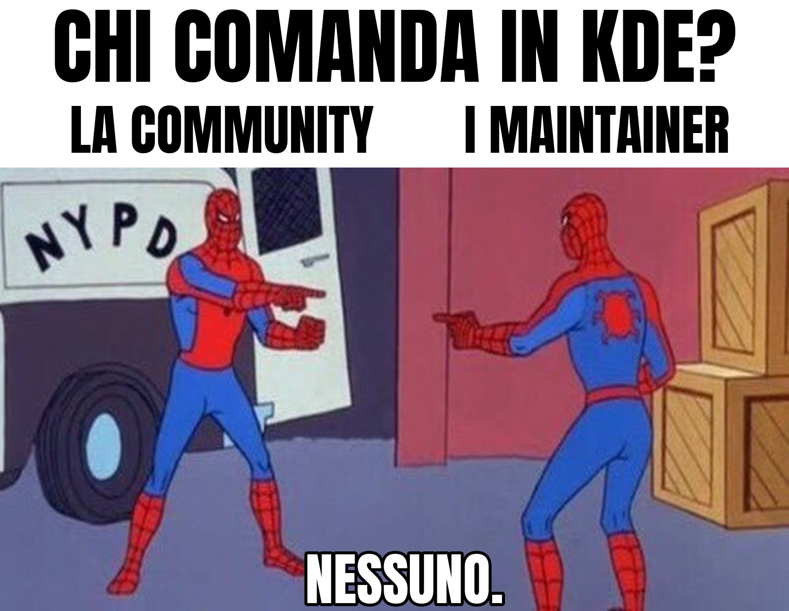

---

<!-- NUOVO -->
{.oss}
### Intanto, nel mondo open source
E i soldi, i server, il marchio, le conferenze?
KDE e.V.: un'associazione no-profit
--
Paga tutto questo. Ma non decide cosa va nel codice
(nel 2025: circa 850 mila euro di entrate, quasi tre quarti da donazioni e soci sostenitori)
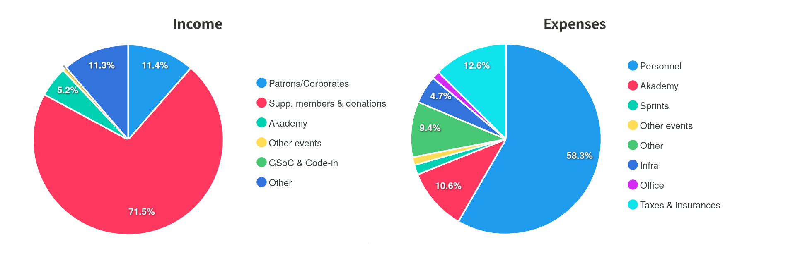

---

<!-- NUOVO -->
{.oss}
### Intanto, nel mondo open source
Una comunità che lavora tutta da remoto ha bisogno di vedersi:
- Akademy: la conferenza annuale (quella di Milano)
- Sprint: pochi giorni, poche presone, un tema
--
(le cene contano quanto i talk. Forse di più)
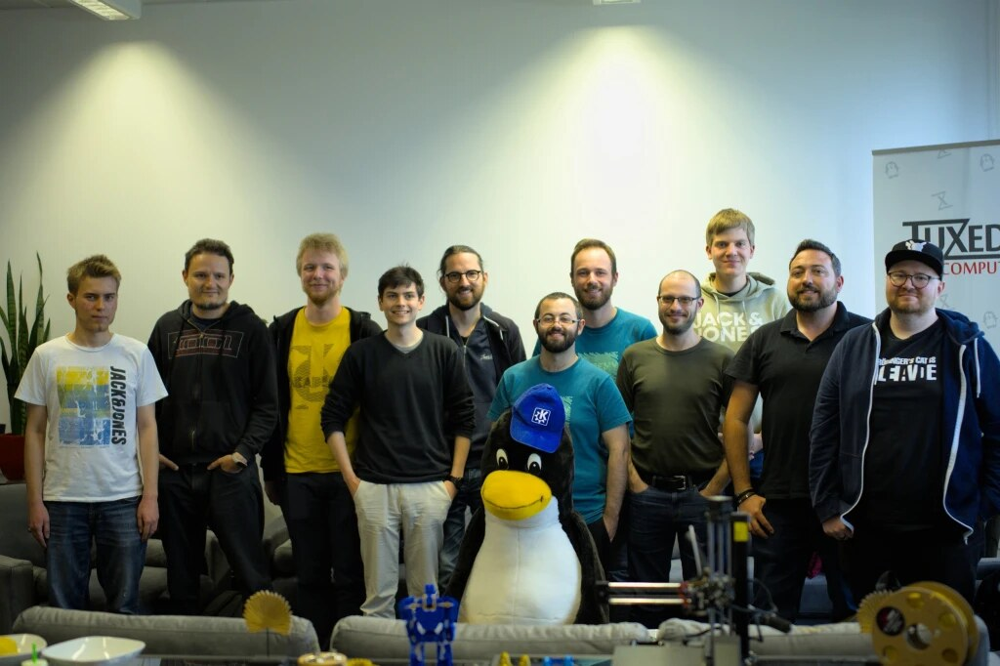
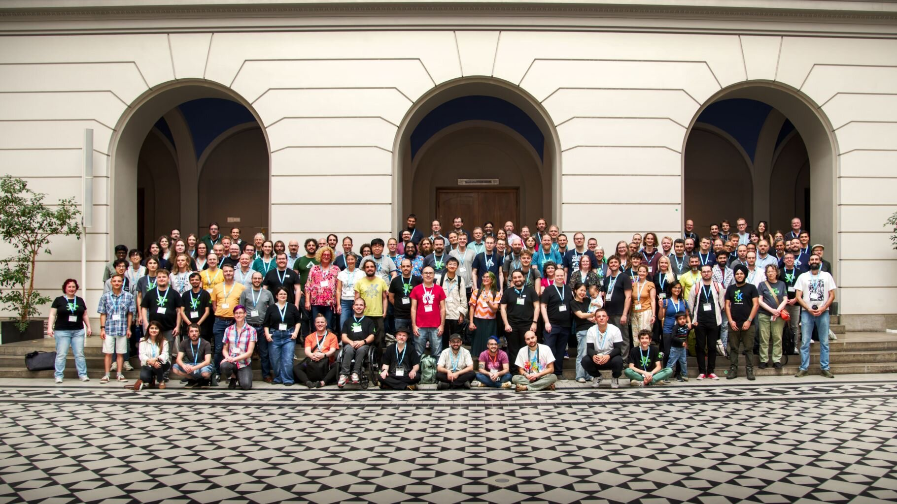

---

Ho passato mesi a fare riunioni ogni paio di settimane, scrivere blogpost sui progressi del Goal, eccetera
Non sapevo programmare bene ma ho fatto: grafiche, video, post, consigli, contattare persone, comunicazione QUALSIASI COSA
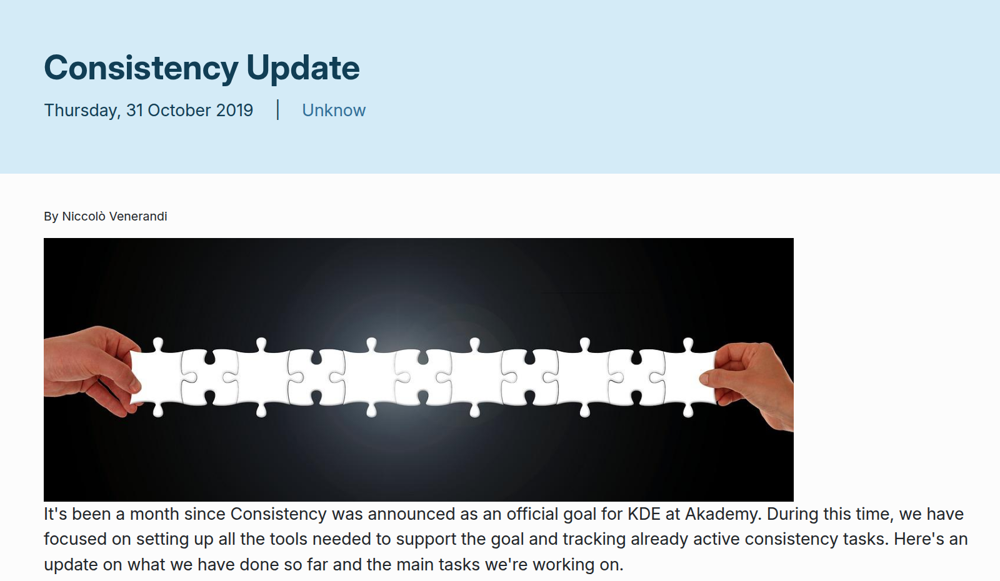

---

{.oss}
### Intanto, nel mondo open source
I progetti Open Source sono generalmente PIENI di programmatori
Purtroppo, i programmatori sono spesso non un granché in: UI/UX, comunicazione e promozione, leadership, internazionalizzazione, ricerca e gestione fondi.
--
Qualsiasi skill abbiate, o siate disposti a svilupare, è super utile

---

<!-- NUOVO -->
{.oss}
### Intanto, nel mondo open source
Infatti in KDE ci sono interi team che non programmano:
- Traduzioni (c'è anche il team italiano)
- Promo
- Design (il Visual Design Group)
- Documentazione
--
(ognuno con le sue chat, le sue riunioni, il suo modo di organizzarsi)
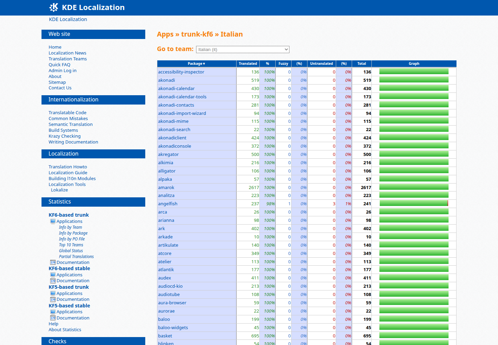
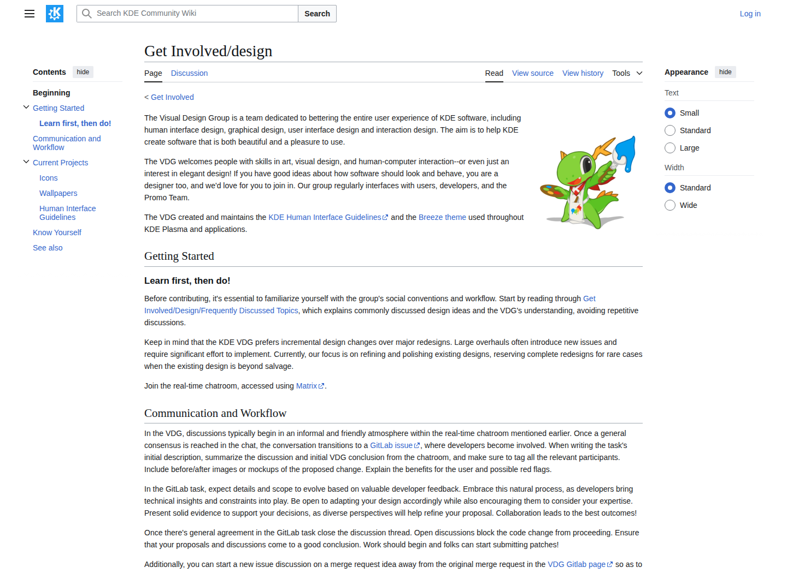

---

## COME CERCARE DI FARE COLPO
Un giorno le chat di KDE dicono che sta per succedere qualcosa di grosos
Mi mandano un link a una diretta di Valve. Mi metto le cuffie mentre vado in università (sono in ritardo)
--
Annunciano lo SteamDeck
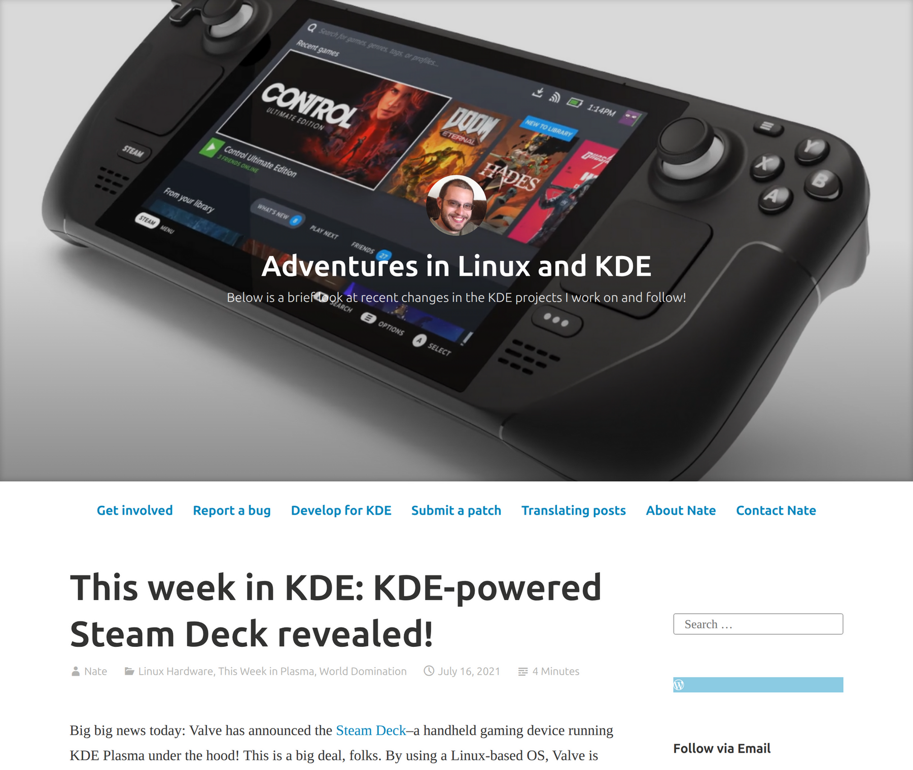
Note: annunciato il 15 luglio 2021 (sito + trailer); non ho trovato conferma che fosse una diretta: verifica.

---

Lo SteamDeck, che ha venduto MILIONI di unità, è una console che gira Linux e in particolare KDE Plasma
--
Spoiler: questo vuol dire che Valve spende un fottio™ di soldi per migliorare KDE
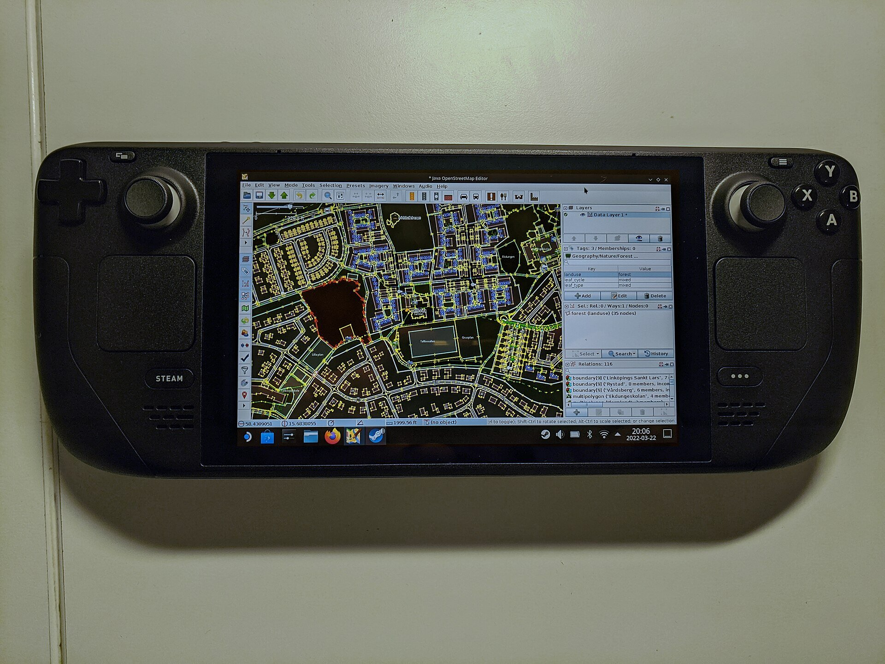
Note: «multiple millions» (Valve, nov 2023); IDC stima ~3,7–4 milioni (feb 2025).

---

<!-- NUOVO -->
{.oss}
### Intanto, nel mondo open source
Perché un'azienda paga per software che chiunque può usare gratis?
--
Perché le serve, e farselo da sola costerebbe molto di piu
(Valve vende giochi, non desktop: le conviene che il desktop sia ottimo, anche se è di tutti)
--
E non fa beneficenza: paga direttamente chi ci lavora
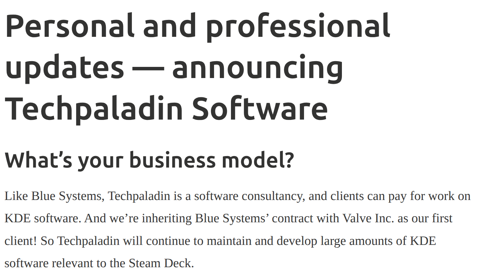
Note: Valve non compare tra patron/supporter di KDE e.V.; secondo il report 2025, Techpaladin (nuovo patron) è fondata da contributori che lavorano su KDE «for Valve and Qt Group».

---

## COME MIGLIORARSI LA VITA
Dopo la quinta sono andato a studiare MATEMATICA
(Una delle uniche cose che non serve ai progetti Open Source)
--
E, al posto di seguire lezione, leggevo i PDF su come programmare in JavaScript sul cellulare
--
(Ho preso la triennale in sei anni)
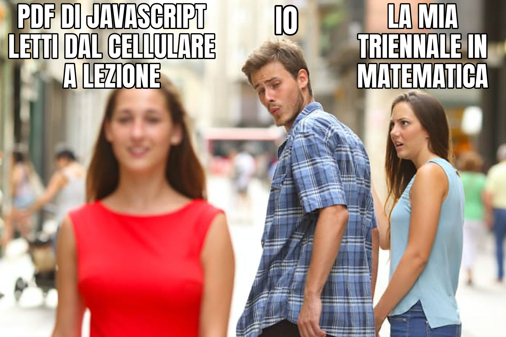

---

In compenso ho imparato:
- a programmare nuove funzionalità
- a fare video per spiegare le nuove funzionaltà
- a fare grafica e animazione per fare i video di lancio
- a tenere talk all'Akademy per spiegare i progressi del Goal
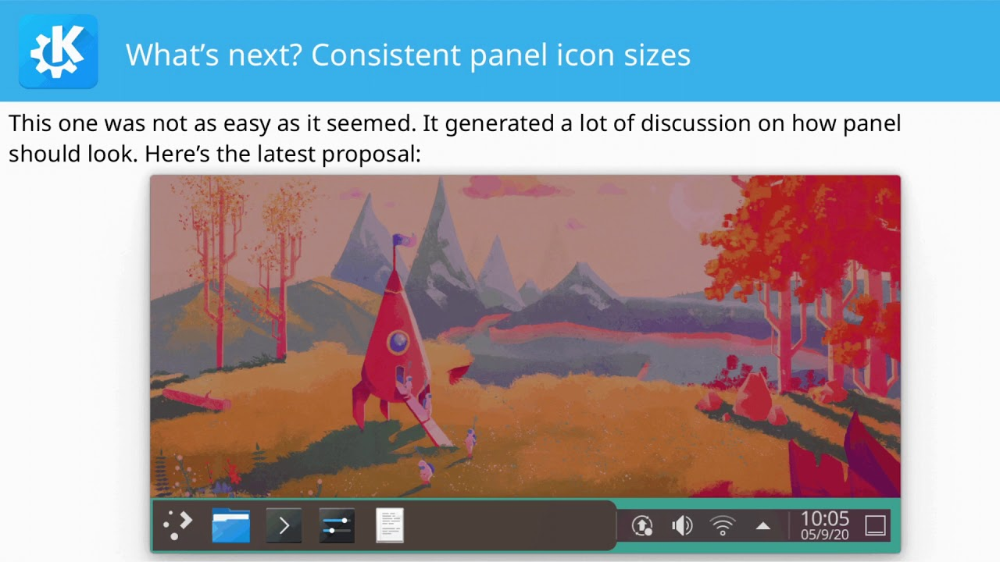
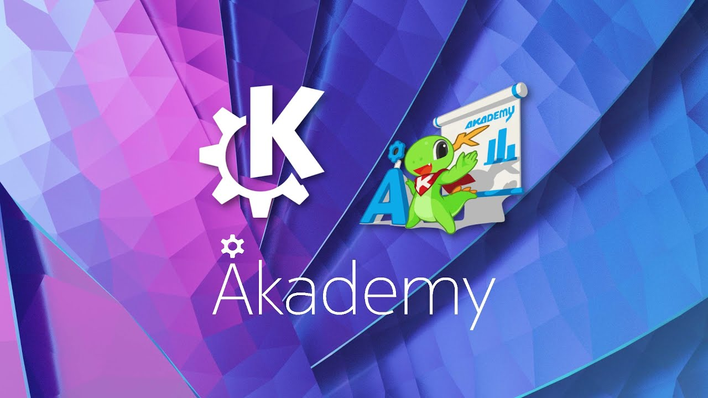

---

{.stack}
E, come risultato:
- Sono stato assunto come programmatore
- Ho creato un canale YouTube e mi hanno assunto come videomaker
- Sono stato assunto come grafico e per animazioni vettoriali
--
- Mi hanno invitato alla Sapienza a tenere una talk
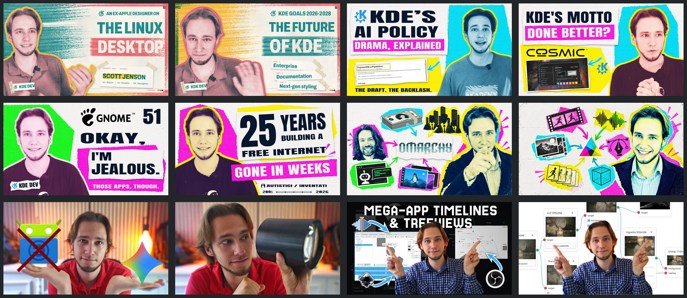

---

Durante l'Akademy dopo che ho finito il mio Goal (a Salonicco, Grecia) sono stato circondato da tre dei migliori sviluppatori KDE tra un talk e l'altro
--
Gli ho chiesto cosa volesero
--
Mi hanno detto "farmi un colloquio di lavoro". Avanzavano dei soldi di Valve
--
Un mese dopo ho firmato il contratto. Ha cambiato la mia vita

---

## COME LAVORARE SU KDE
Lavorare ≠ Essere volontario
Anche noi abbiamo una classifica da seguire: bugs.kde.org
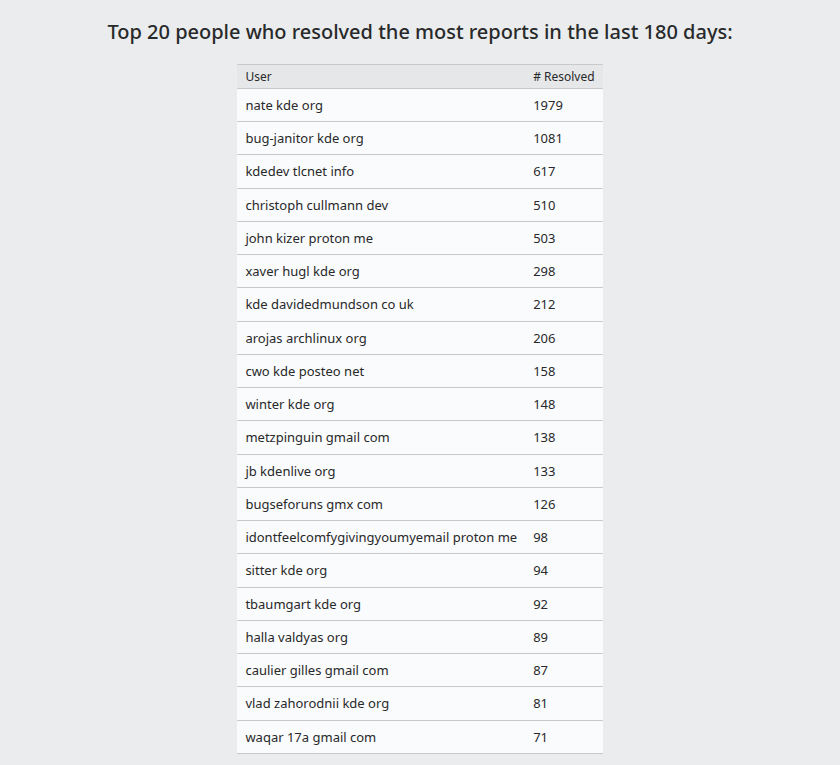

---

Benvenuti nel mondo del TRIAGING
- Guardare la lista di bug
- Uno per uno, controllare se riesci a riprodurlli
- Mancano informazioni? Sono ancora validi?
- Sono nel progetto giusto? Vanno spostati?
- Si possono risolvere facilmente? È qualcosa che vogliamo davvero fare?

In questo modo si chiudono centinaia di bug report.
--
COME FARSI ASSUMERE: essere in cima a quella leaderboard per qualche mese
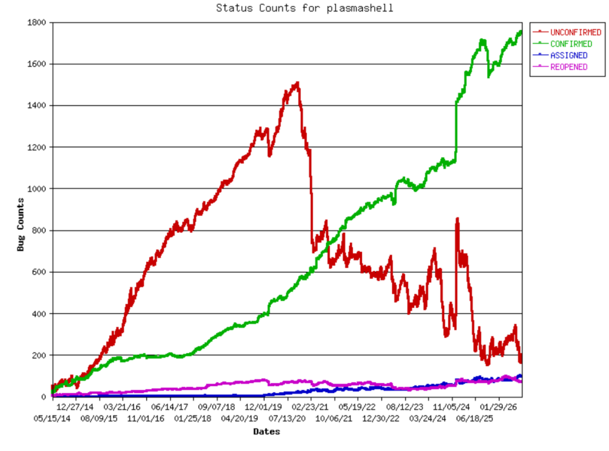

---

## COME ANDARE IN BURNOUT
Un anno fa stavo passeggiando sotto casa mia, camminando avanti indietro
--
Dovevo lavorare. (Non stavo lavorando). ((Non riuscivo proprio a lavorare)).
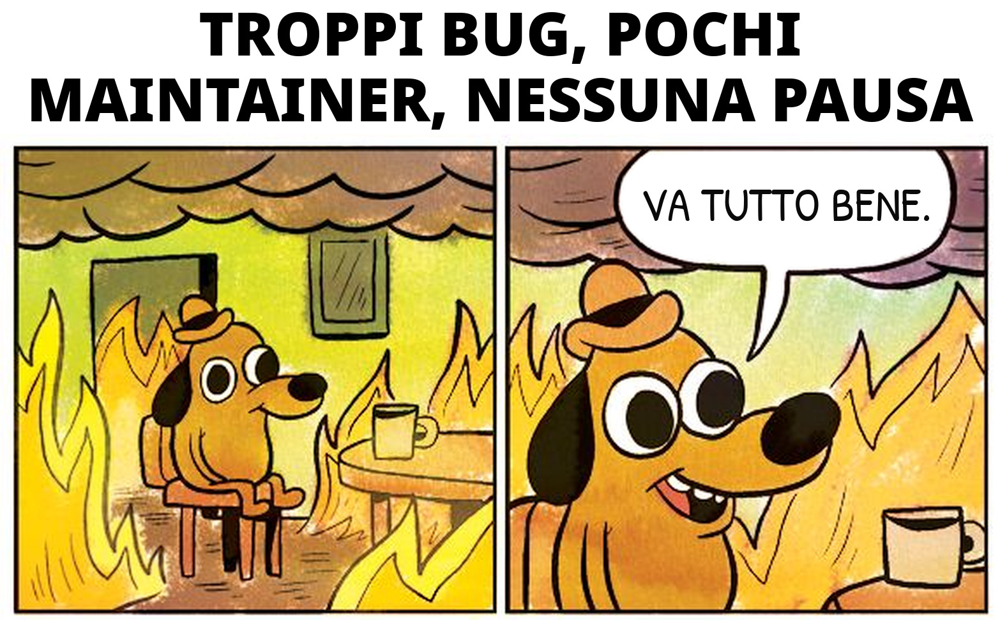

---

Avevo avvertito che prima o poi mi sarei licenziato per tornare a fare video.
Ma non ce la facevo più. Ho tirato fuori il cellulare e ho mandato un messaggio per licenziarmi istintivamnete.
--
E poi sono corso al McDonald's per festeggiare la decisione, mentre andavo nel panico.
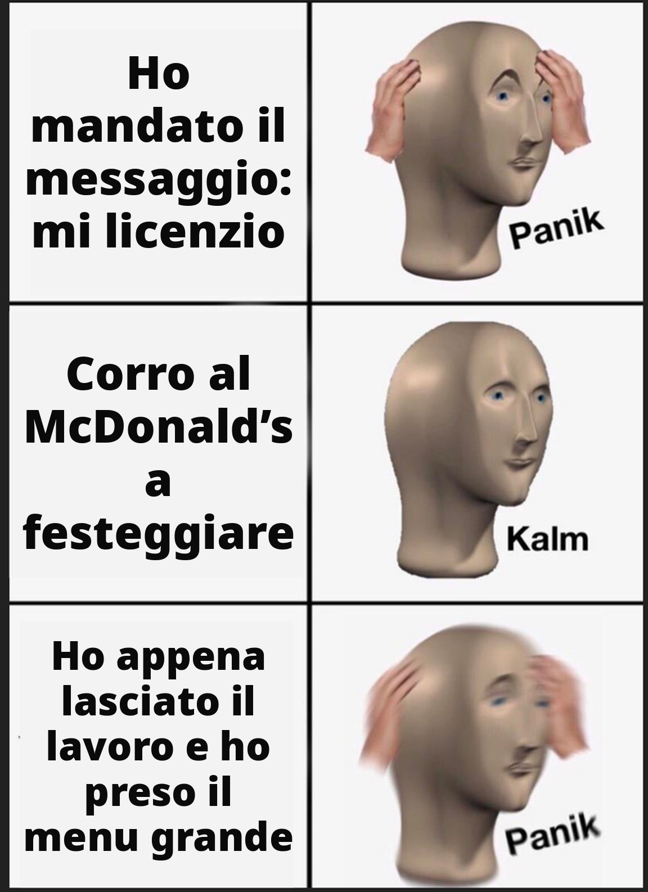

---

{.oss}
### Intanto, nel mondo open source
Le comunità Open Source sono:
- Full remote (non è una buona cosa)
- Fonte occasionale di conflitti
- Molto faticose
- Troppo piccole per il lavoro che fanno
- Piene di persone in burnout
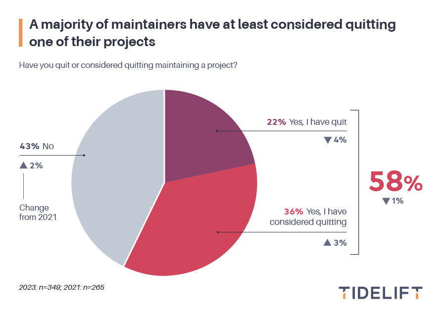

---

{.oss}
### Intanto, nel mondo open source
Circa due anni e mezzo fa, il burnout ha quasi consegnato l'intero internet a un hacker
(probabilmente un gruppo, forse finanziato da uno Stato)
--
- Hanno trovato un maintainer in burnout
- Si sono offerti di aiutare e hanno dato una mano per anin
- Dopo essersi guadagnati la fiducia, hanno inserito una backdoor nascosta

---

{.oss}
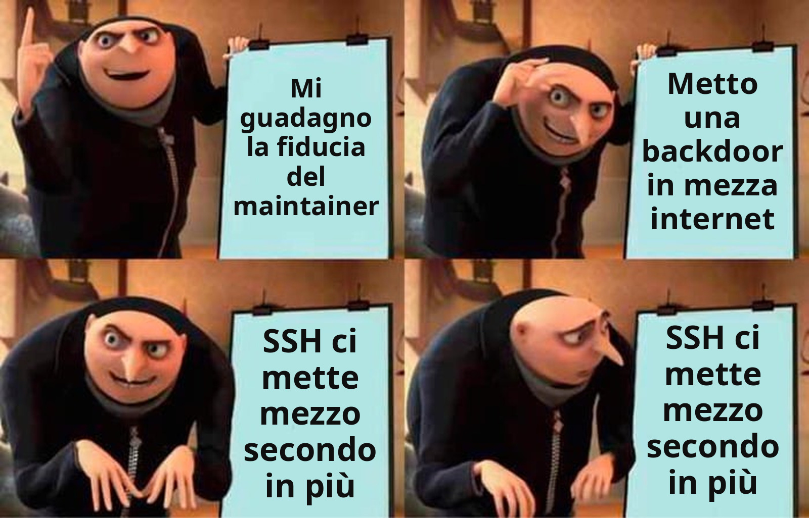

---

{.oss}
### Intanto, nel mondo open source
Il mantainer in burnout non l'ha notato
La backdoor era già nelle versioni di test di Debian e Fedora, a pochi passi dalle release
--
All'ultimo secondo prima delle release, un dev Microsoft si è accorto per caso della backdoor
(Andres Freund: SSH ci metteva mezzo secondo di troppo)
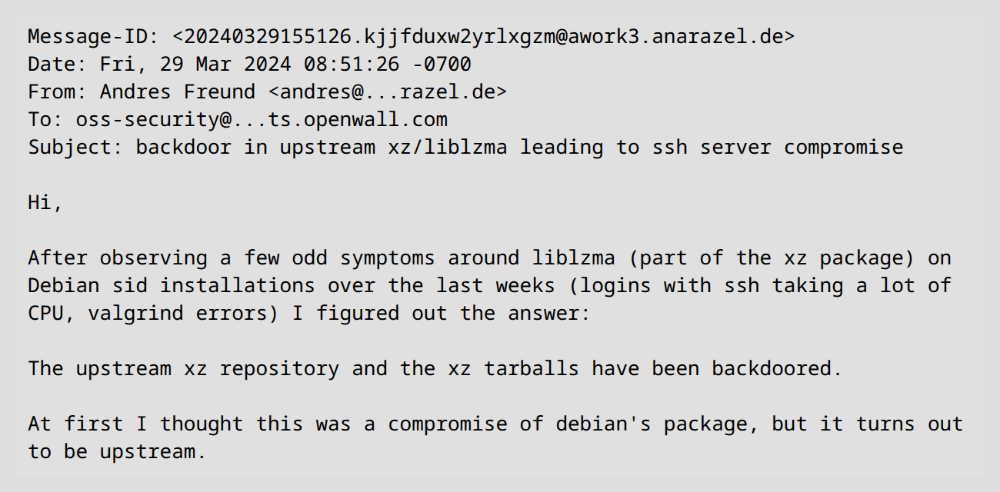

---

<!-- NUOVO -->
## COME NON BRUCIARSI
Note: parli tu. Promemoria:
- Datevi dei limiti (il progetto sopravvive anche se stasera non rispondete)
- Contribuite a quello che vi interessa, non a quello che «dovreste»
- Chiedete aiuto prima di averne bisogno
--
- Ricordatevi che dall'altra parte ci sono persone (anche quando vi bocciano la merge request)

---

<!-- NUOVO -->
## COME INIZIARE (DAVVERO)
Se volete programmare:
- Season of KDE: un progetto con un mentor, candidature a dicembre, lavoro da gennaio a marzo
- Google Summer of Code: uguale, ma PAGATO (candidature a marzo, lavoro d'estatte)
- I bug marcati «junior-jobs» su bugs.kde.org (oggi ce ne sono 256)
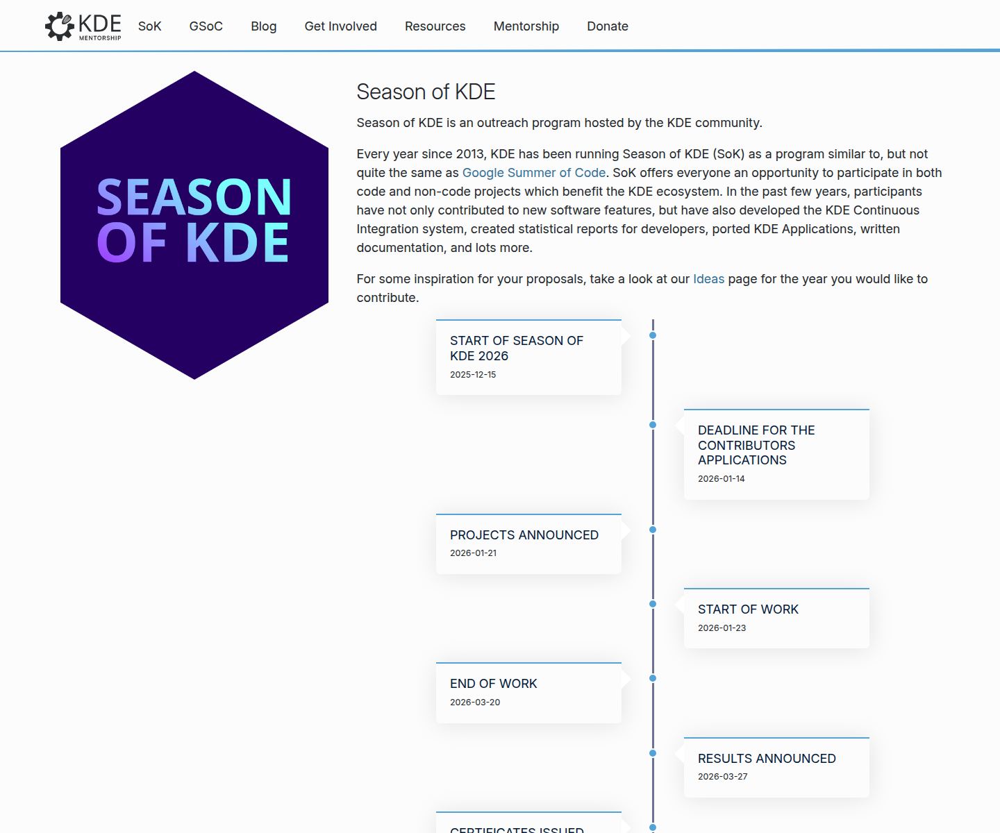
Note: date dell'edizione 2026. SoK 2026: candidature 15 dic – 14 gen, lavoro 23 gen – 20 mar. GSoC 2026: candidature 16–31 mar, lavoro 25 mag – fine ago; in Italia 1.200 / 2.400 / 4.800 $ a seconda della taglia. Le date 2027 non sono ancora uscite.

---

<!-- NUOVO -->
Se non volete programmare:
- Triaging
- Traduzioni in italiano
- Promo, design, documentazione
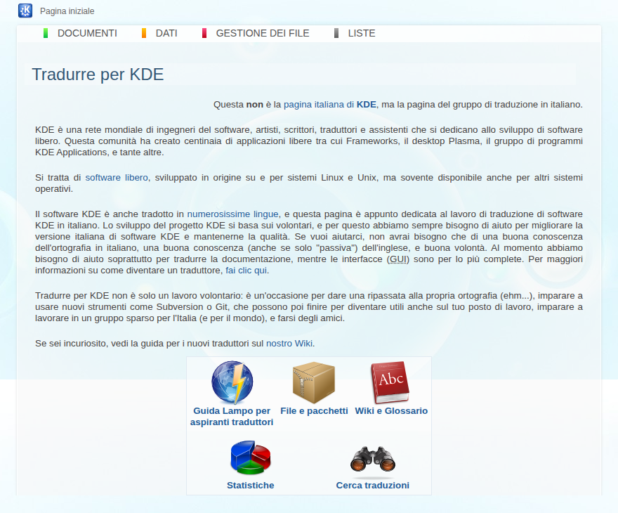

---

<!-- NUOVO -->
{.side}
community.kkde.org/Get_Involved
nicco.love
youttube.com/@niccoloveslinux
fossstodon.org/@niccolove
Grazie!

